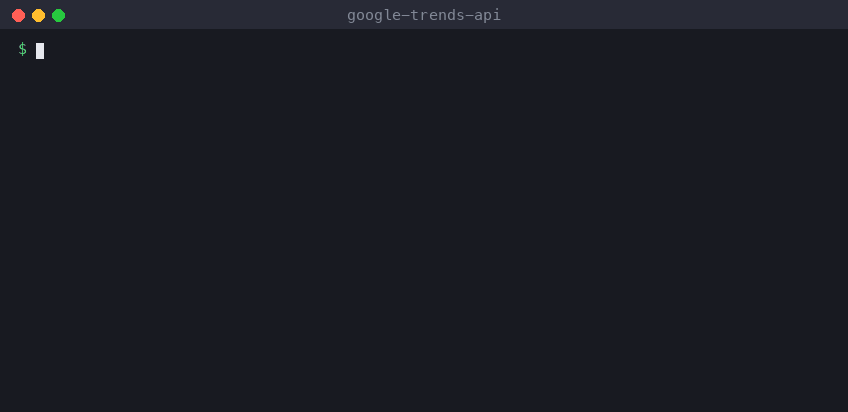

# Google Trends API for Python and JavaScript

A maintained way to get Google Trends data from code, after [pytrends](https://github.com/GeneralMills/pytrends) was archived:
- interest over time
- interest by region
- related queries (top and rising)
- related topics

It works for any country, time range and search vertical (Web, YouTube, News, Images, Shopping).



**Guides:** [pytrends alternative: fixing 429 errors](docs/pytrends-alternative.md) · [Google's trending searches in Python](docs/trending-searches-python.md)

```python
from google_trends_api import TrendReq   # was: from pytrends.request import TrendReq

pytrends = TrendReq()
pytrends.build_payload(["chatgpt", "gemini", "claude"], timeframe="today 3-m", geo="US")
pytrends.interest_over_time().tail(3)
```
```
            chatgpt  gemini  claude  isPartial
date
2026-11-01       53      21      16      False
2026-11-02       79      32      23      False
2026-11-03       71      32      22       True
```

## How it works, and what it costs
Google has no public Trends API, and its website rate-limits scripts quickly. That's why pytrends users hit `429 Too Many Requests` constantly.

This library doesn't call Google from your machine. Each call starts a run of a hosted scraper, [Google Trends Scraper on Apify](https://apify.com/seodatalab/google-trends-scraper?fpr=fi898m), which handles rotating IPs, retries and backoff. The library then returns the results.

**You need a free Apify account and its API token:**
1. Sign up at [apify.com](https://apify.com?fpr=fi898m).
2. Copy the token from *Settings → API & Integrations*.
3. Set it with `export APIFY_TOKEN=...`.

**Pricing is pay-per-use:**
- $0.02 per call (run).
- $0.002 per search term.
- $0.001 for each extra section that returns data.
- For example, 100 keywords in one call cost about $0.22.
- Failed queries aren't charged.
- Apify's free plan includes monthly credit, which covers casual use.

*Disclosure: the maintainer of this repo also publishes that scraper. The client code is MIT, and you can point it at any actor with the same input (`actor=`). Links to apify.com include my referral code, so Apify may pay me a commission if you sign up. It doesn't change your price.*

## Install
```bash
pip install "google-trends-api[pandas] @ git+https://github.com/carterprice2/google-trends-api"
```
The core client has no dependencies. Pandas is only needed for the pytrends-compatible `TrendReq`.

For JavaScript (Node 18+), copy [`js/index.mjs`](js/index.mjs). It's a single file with no dependencies.

## Python
### Migrating from pytrends
`TrendReq` supports these pytrends calls and returns DataFrames shaped like pytrends' output:
- `build_payload(kw_list, cat, timeframe, geo, gprop)`
- `interest_over_time()`
- `interest_by_region()`
- `related_queries()`

Constructor arguments such as `hl`, `tz`, `retries`, `backoff_factor` and `proxies` are accepted and ignored, because retries and proxies now happen server-side.

### Batch API (faster, cheaper)
pytrends needed one request per keyword group. Here, one call can process hundreds of queries in parallel:
```python
from google_trends_api import GoogleTrends

gt = GoogleTrends()  # reads APIFY_TOKEN
rows = gt.fetch(
    ["air fryer", "standing desk", "iphone, samsung galaxy"],   # comma = compare on one chart (max 5)
    geo="US", timeframe="today 12-m",
    sections=["interestOverTime", "interestByRegion", "relatedQueries"],
)
for r in rows:
    print(r["searchTerm"], r["interestOverTime"][-1]["values"], r["relatedQueries"])
```
Plain-dict helpers, no pandas needed:
- `gt.interest_over_time(["a", "b"])`
- `gt.interest_by_region(...)`
- `gt.related_queries(...)`

**Time frames:**
- presets: `now 1-H`, `now 4-H`, `now 1-d`, `now 7-d`, `today 1-m`, `today 3-m`, `today 12-m`, `today 5-y`, `all`
- custom: `"2024-01-01 2024-06-30"`

**Search verticals (`property`):** `web`, `youtube`, `news`, `images`, `shopping`. pytrends' `gprop` values also work, including `froogle`.

## JavaScript
```js
import { GoogleTrends } from './index.mjs';

const gt = new GoogleTrends({ token: process.env.APIFY_TOKEN });
const rows = await gt.interestOverTime(['air fryer'], { geo: 'GB', timeframe: 'today 1-m' });
// [{ date: '2026-11-03T00:00:00.000Z', isPartial: true, 'air fryer': 38 }, ...]
```

## Output
Values are Google's relative interest, from 0 to 100. Rising related queries are percentage growth, and "Breakout" means more than +5000%. Full item format:
```json
{
  "searchTerm": "iphone, samsung galaxy",
  "keywords": ["iphone", "samsung galaxy"],
  "interestOverTime": [{ "date": "2026-08-03T00:00:00.000Z", "isPartial": false, "values": { "iphone": 46, "samsung galaxy": 2 } }],
  "interestByRegion": [{ "geoCode": "US-KS", "geoName": "Kansas", "values": { "iphone": 95, "samsung galaxy": 5 } }],
  "relatedQueries": { "iphone": { "top": [{ "query": "iphone 18", "value": 100 }], "rising": [{ "query": "iphone duo release date", "value": 13150, "formattedValue": "Breakout" }] } }
}
```

## FAQ
**Is there an official Google Trends API?**
Google announced one as an alpha in 2025 for a limited set of testers. If you have access, use it. This library is for everyone else.

**Why not just fix pytrends' 429 errors?**
The 429s come from Google limiting requests per IP. Fixing them means rotating IPs and backing off, which this library does on the server side.

**Can I trust the rising queries?**
Google sometimes slips generic, unrelated "rising" queries into results it serves to automated traffic, for example "learn golang" as a rising search for *protein powder*. The scraper detects lists like that and keeps only queries that belong to the keyword. It reports the number removed as `risingRemoved`. Top queries and interest over time aren't affected.

**Is it free?**
The code is free. Running queries costs Apify credit, as shown above.

## Development
```bash
python -m pytest tests        # offline, uses a recorded real response
cd js && npm test
```

MIT licensed.
