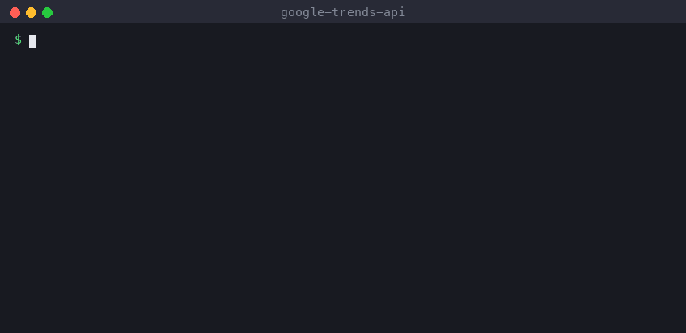

# pytrends alternative (2026): fixing "429 Too Many Requests" for good

If your pytrends script stopped working, you're not alone. The two most-discussed issues in its tracker are ["It broke again"](https://github.com/GeneralMills/pytrends/issues?q=It+broke+again) and ["Google returned a response with code 429"](https://github.com/GeneralMills/pytrends/issues?q=429). There are more than 100 comments between them.

This guide explains what changed, what your options are, and how to move existing pytrends code over with a one-line change.



## What happened to pytrends
- [GeneralMills/pytrends](https://github.com/GeneralMills/pytrends) is **archived**. Its last commit was August 2024, it has 152 open issues, and its README asks for new maintainers.
- pytrends calls the same internal endpoints the Google Trends website uses. Google limits those per IP address. A laptop or a cloud server gets a few requests, then `429 Too Many Requests` for minutes or hours.
- Every Google-side change needs a code fix, and nobody is shipping fixes anymore.

## Your options
| Option | Good for | Catch |
|---|---|---|
| **Official Google Trends API** (alpha, announced 2025) | Anyone who got access | Limited testers only. Apply through Google. If you're in, use it. |
| **Keep pytrends, add proxies and sleeps** | Hobby scripts, a few queries a day | You maintain the proxy pool, retries and every future breakage yourself. |
| **This library** ([google-trends-api](https://github.com/carterprice2/google-trends-api)) | Scripts and pipelines that need to keep working | Pay-per-use: about $0.02 per call plus $0.002 per keyword. |

## Migrating takes one line
```python
# before
from pytrends.request import TrendReq
# after
from google_trends_api import TrendReq

pytrends = TrendReq(hl="en-US", tz=360)          # same constructor, extra args are ignored
pytrends.build_payload(["chatgpt", "gemini", "claude"], timeframe="today 3-m", geo="US")
df = pytrends.interest_over_time()               # same DataFrame shape: date index, one column per keyword, isPartial
regions = pytrends.interest_by_region()          # indexed by geoName
related = pytrends.related_queries()             # {"chatgpt": {"top": DataFrame, "rising": DataFrame}, ...}
```
Real output from the code above, run on 2026-11-04:
```
            chatgpt  gemini  claude  isPartial
date
2026-10-31       51      21      17      False
2026-11-01       53      21      17      False
2026-11-02       81      34      27      False
2026-11-03       80      32      24      False
2026-11-04       60      27      18       True
```

**Install and set a token:**
```bash
pip install "google-trends-api[pandas] @ git+https://github.com/carterprice2/google-trends-api"
export APIFY_TOKEN=...   # free account at apify.com, then Settings → API & Integrations
```

## Why it doesn't hit 429
Your code never calls Google directly. Each call starts a run of a hosted scraper ([Google Trends Scraper on Apify](https://apify.com/seodatalab/google-trends-scraper?fpr=fi898m)):
- It spreads requests over rotating IPs.
- It backs off and retries.
- It only returns a result once Google has actually answered.

Failed queries come back as errors and aren't charged.

## Going faster than pytrends
pytrends made one request per keyword group, so people looped with `time.sleep(60)`. Here, one call handles hundreds of queries in parallel:
```python
from google_trends_api import GoogleTrends

gt = GoogleTrends()
rows = gt.fetch([f"{city} weather" for city in ["london", "paris", "berlin", "madrid", "rome"]],
                geo="", timeframe="today 12-m", sections=["interestOverTime", "interestByRegion"])
```
100 keywords in one call cost about $0.22.

## What's different from pytrends
- **Supported:** `build_payload`, `interest_over_time`, `interest_by_region` and `related_queries`.
- **Not ported (yet):** `suggestions`, `realtime_trending_searches`, `top_charts`. For today's trending searches, see [trending searches in Python](trending-searches-python.md).
- **Rising related queries are filtered.** Google sometimes slips unrelated "rising" queries into answers it gives to automated traffic. We've seen "cloud storage pricing" listed as rising for *standing desk*. The scraper removes lists like that and reports how many it dropped in `risingRemoved`. So rising lists can be shorter than on the website, but what's there is real.

*Disclosure: I maintain this library and the Apify scraper it calls. Links to apify.com include my referral code, so Apify may pay me a commission if you sign up. It doesn't change your price.*
