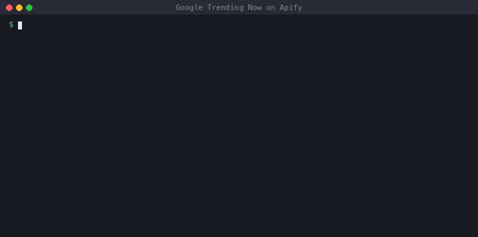

# Get Google's trending searches in Python (Trending Now)

Google's [Trending Now](https://trends.google.com/trending) page shows what people are searching for right now, for any country, with:
- approximate search volume
- how fast each search is growing
- when it started
- related searches

This guide pulls that list into Python.



## The code
```bash
pip install apify-client
export APIFY_TOKEN=...   # free account at apify.com, then Settings → API & Integrations
```
```python
import os
from apify_client import ApifyClient

client = ApifyClient(os.environ["APIFY_TOKEN"])
run = client.actor("seodatalab/google-trending-now").call(
    run_input={"geos": ["US"], "timeWindow": "24h", "sortBy": "searchVolume", "maxItemsPerLocation": 6})
for t in client.dataset(run.default_dataset_id).iterate_items():
    print(f'{t["rank"]}. {t["title"][:28]:<28} {t["searchVolume"]:>10,}+  +{t["increasePercent"]}%')
```
Real output from election night, 2026-11-04:
```
1. 2026 us election results     10,000,000+  +1000%
2. ohio election results         2,000,000+  +1000%
3. texas voting results          1,000,000+  +1000%
4. ohio governor race            1,000,000+  +1000%
5. michigan election results       500,000+  +1000%
6. resultados de las elecciones    500,000+  +1000%
```

## Options
| Input | Values |
|---|---|
| `geos` | Any number of countries or regions: `["US", "GB", "IN", "US-CA"]` |
| `timeWindow` | `4h`, `24h`, `48h`, `7d` |
| `sortBy` | `relevance` (Google's order), `searchVolume`, `newest` |
| `activeOnly`, `minSearchVolume`, categories | Filters, such as only Sports or only Technology |
| `maxItemsPerLocation` | Cap per country, `0` = all (often 500+ in the US over 24h) |

Each item also includes:
- `relatedSearches`: the other queries Google groups into the trend
- `startedAt` and `isActive`
- `categories`
- `exploreUrl`

## Ideas
- **Newsjacking alerts.** Schedule the actor every hour on Apify, keep the titles you haven't seen yet, and post them to Slack.
- **Content briefs.** Feed `relatedSearches` into your outline.
- **Trend over time.** Pass a trending `title` to [`google_trends_api`](../README.md) to see whether it's a spike or a growing trend.

## Cost
- $0.02 per run plus $0.50 per 1,000 trends returned.
- The run above (6 trends) cost about $0.023.

*Disclosure: I maintain the Google Trending Now actor used here.*
